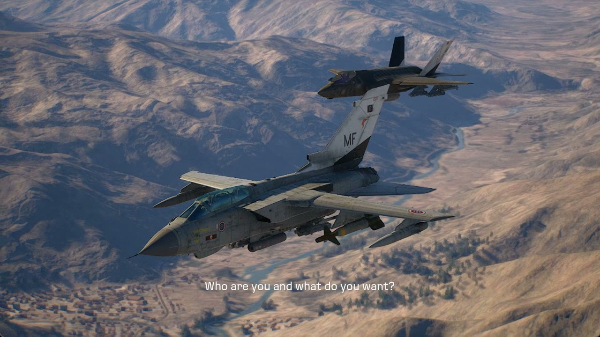

# Tornado_GR4_ac8_temp
Testing Tornado GR4 before nexus upload

## Current test release

[Tornado GR.4 Add-On 1.0.1](https://github.com/VTEC-EK9/Tornado_GR4_ac8_temp/releases/tag/v1.0.1) for ACE COMBAT 8: WINGS OF THEVE. Download the add-on ZIP from the release assets. The ZIP README lists the required Nexus dependencies, installation instructions, and credits.

SHA-256

```text
186c634262e07adbc97ae4ef753f574e4208049caeffc158e40d40b92be3b963
```

## Screenshots

<table>
  <tr>
    <td></td>
    <td></td>
  </tr>
  <tr>
    <td></td>
    <td></td>
  </tr>
</table>
