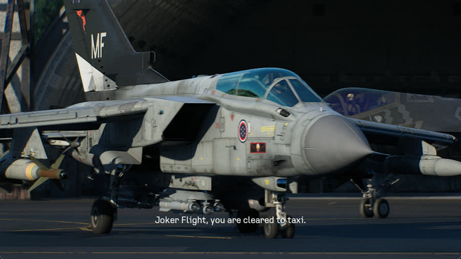
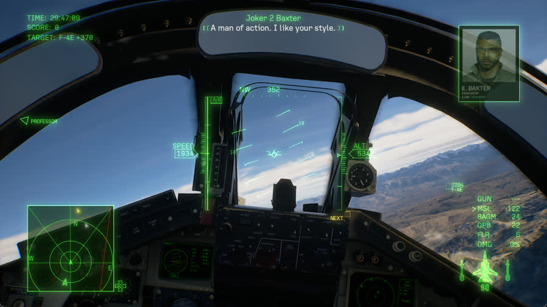
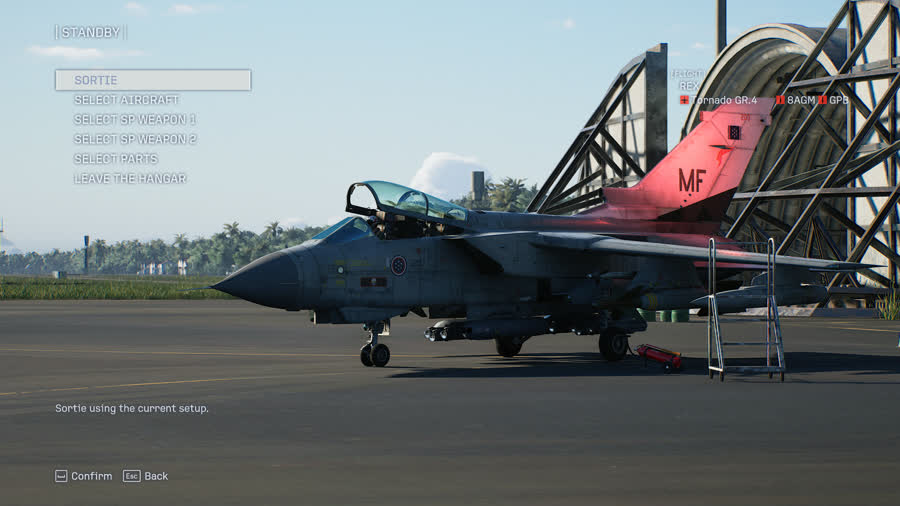

# Tornado_GR4_ac8_temp
Testing Tornado GR4 before nexus upload

## Current test release

[Tornado GR.4 Add-On 1.0.10](https://github.com/VTEC-EK9/Tornado_GR4_ac8_temp/releases/tag/v1.0.10) for ACE COMBAT 8: WINGS OF THEVE on Windows.

## Installation

1. Open ACE8 Mod Launcher 2.1.3 and choose **Set up modding** if this is your first mod. The launcher installs UE4SS and War’s Mod Loader 1.3.1. [ACE8 Mod Launcher](https://www.nexusmods.com/acecombat8wingsoftheve/mods/64)
2. Download the [Tornado GR.4 1.0.10 ZIP](https://github.com/VTEC-EK9/Tornado_GR4_ac8_temp/releases/download/v1.0.10/Tornado-GR4-Add-On-1.0.10.zip). In the launcher, choose **Mods → Add a mod…** and select the ZIP.
3. Check that `TornadoGR4_addon`, `TornadoGR4-us4ss`, and `SkinSlotText` are on. Choose **Play Modded** for offline single-player.

If updating from a previous release, close the game and remove the older Tornado entries in the launcher before adding this ZIP. One import installs the complete aircraft.

If you installed the separate GR.4 radar, nozzle, or Joker tail development patches, disable or remove them before updating. This ZIP includes those updates.

SkinSlotText is by NotalieNNA. [ACE8 Skin Studio by NotalieNNA](https://www.nexusmods.com/acecombat8wingsoftheve/mods/52)


SHA-256

```text
7c5fe9fe92ab6f8134b4a0df70ccbbd9cecc8d7b092028270a2e99eb1edffdad
```

## Changelog

### 1.0.10

- revamped skins

### 1.0.9

- Merged the radar, nozzle, and Joker tail updates into the main Tornado IoStore package.

### 1.0.8

- Fixed the all-Tornado sortie crash.
- Updated Joker tail markings.

### 1.0.7

- fixed wingmen SPW
- fixed nozzle animations
- fixed radar MFD

### 1.0.6

- fixed 3rd person and cockpit hud jittering

### 1.0.5

- fixed flares coming out of the flare pod

### 1.0.4

- fixed cockpit animations
- fixed afterburner placement

## Screenshots

<table>
  <tr>
    <td></td>
    <td></td>
  </tr>
  <tr>
    <td></td>
    <td></td>
  </tr>
</table>
